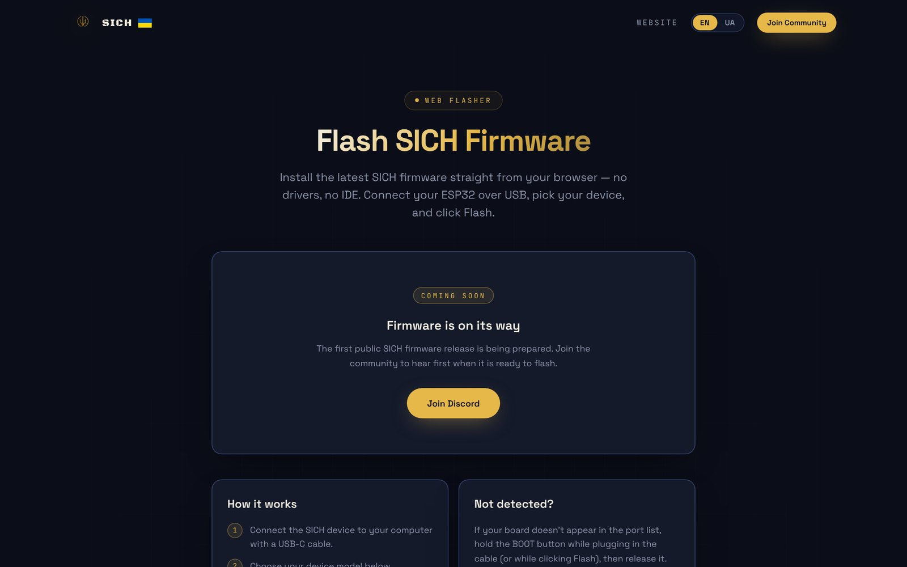
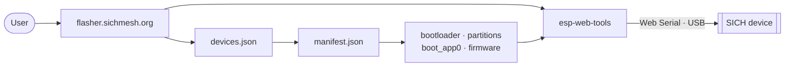

<div align="center">


# SICH Web Flasher

**Install SICH firmware from your browser. No drivers, no IDE.**

[](LICENSE)
[](https://github.com/sichmesh/web-flasher/actions/workflows/deploy.yml)
[](https://flasher.sichmesh.org)
[](https://discord.gg/zpVgjRxdQJ)


[**Open the flasher**](https://flasher.sichmesh.org) · [**Website**](https://sichmesh.org) · [**Discord**](https://discord.gg/zpVgjRxdQJ)

**English** · [Українська](README.uk.md)

<br />



</div>

<br />

## About

The official web flasher for [SICH](https://sichmesh.org), an off-grid LoRa mesh communication device.

Plug the device in over USB, pick the model and click **Flash**. The browser writes the firmware straight to the board using the Web Serial API.

> [!IMPORTANT]
> Web Serial works in desktop **Chrome** and **Edge**. Firefox, Safari and mobile browsers are not supported.

## Supported devices

> [!NOTE]
> The first public SICH firmware release is coming soon. Until then the flasher shows a placeholder. Follow [Discord](https://discord.gg/zpVgjRxdQJ) for the announcement.

| Device | Chip | Firmware |
|---|---|---|
| SICH — ESP32-S3 (N16R8) | ESP32-S3 | Coming soon |

## Adding a device

Board makers are welcome to add their hardware. A device is just a folder with firmware images and one entry in a JSON file — no code changes.

**1. Add the firmware** to `public/firmware/<device-id>/`:

```
public/firmware/<device-id>/
├─ manifest.json
├─ bootloader.bin
├─ partitions.bin
├─ boot_app0.bin
└─ firmware.bin
```

`manifest.json` follows the [esp-web-tools manifest format](https://esphome.github.io/esp-web-tools/):

```json
{
  "name": "SICH Firmware",
  "version": "1.0.0",
  "new_install_prompt_erase": true,
  "builds": [
    {
      "chipFamily": "ESP32-S3",
      "parts": [
        { "path": "bootloader.bin", "offset": 0 },
        { "path": "partitions.bin", "offset": 32768 },
        { "path": "boot_app0.bin", "offset": 57344 },
        { "path": "firmware.bin", "offset": 65536 }
      ]
    }
  ]
}
```

**2. Register the device** in `public/firmware/devices.json`:

```json
[
  { "id": "<device-id>", "name": "<Vendor> — <Board>", "manifest": "/firmware/<device-id>/manifest.json" }
]
```

While the list is empty, the page shows the "Coming soon" placeholder.

**3. Open a pull request.** Once merged, the device appears on [flasher.sichmesh.org](https://flasher.sichmesh.org).

The version badge on the page is read from each device's `manifest.json`, so it always matches what gets flashed.

## How it works



## Development

**Requirements:** Node.js 20 or newer.

```bash
git clone https://github.com/sichmesh/web-flasher.git
cd web-flasher
npm install
npm run dev        # http://localhost:3000
npm run build      # static site in ./out
```

## Deployment

The site is fully static. Every push to `main` builds it with GitHub Actions and publishes `./out` to GitHub Pages ([`.github/workflows/deploy.yml`](.github/workflows/deploy.yml)). The custom domain is set in [`public/CNAME`](public/CNAME).

## Related

- [sichmesh](https://github.com/sichmesh/sichmesh) — SICH website

## License

The source code is licensed under the [GNU General Public License v3.0](LICENSE).

The **SICH** name and the trident logo are not covered by this license. See [TRADEMARK.md](TRADEMARK.md).

<div align="center">
<br />
<sub>Developed by Ukrainians 🇺🇦 · <a href="https://www.youtube.com/@BrainFromUkraine">Brain From Ukraine</a></sub>
</div>
