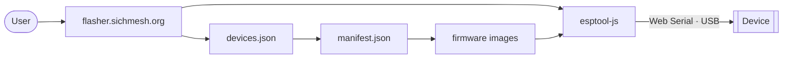

<div align="center">


# SICH Web Flasher

**Install SICH firmware from your browser. No drivers, no IDE.**

[](LICENSE)
[](https://github.com/sichmesh/web-flasher/actions/workflows/deploy.yml)
[](https://flasher.sichmesh.org)
[](https://discord.gg/zpVgjRxdQJ)


[**Open the flasher**](https://flasher.sichmesh.org) · [**Website**](https://sichmesh.org) · [**Discord**](https://discord.gg/zpVgjRxdQJ)

**English** · [Українська](README.uk.md)

<br />


</div>

<br />

## About

The official web flasher for [SICH](https://sichmesh.org), an off-grid LoRa mesh network.

Plug the device in over USB, pick it from the list, choose a version and click **Flash**. The browser writes the firmware straight to the board using the Web Serial API.

> [!IMPORTANT]
> Web Serial works in desktop **Chrome**, **Edge** and **Opera**. Firefox, Safari and mobile browsers are not supported.

## Supported devices

> [!NOTE]
> The first public SICH firmware release is coming soon. Until then the flasher shows a placeholder. Follow [Discord](https://discord.gg/zpVgjRxdQJ) for the announcement.

| Device | Chip | Firmware |
|---|---|---|
| SICH S3 (reference) | ESP32-S3 | Coming soon |

## Adding a device

Board makers are welcome to add their hardware. A device is an image, a folder with firmware and one entry in a JSON file, with no code changes.

**1. Add the firmware** to `public/firmware/<device-id>/<version>/`:

```
public/firmware/<device-id>/<version>/
├─ manifest.json
└─ firmware.factory.bin      (or bootloader.bin, partitions.bin, firmware.bin, …)
```

`manifest.json` follows the [esp-web-tools manifest format](https://esphome.github.io/esp-web-tools/). Part paths are relative to the manifest:

```json
{
  "name": "SICH",
  "version": "2.0.0",
  "builds": [
    {
      "chipFamily": "ESP32-S3",
      "parts": [{ "path": "firmware.factory.bin", "offset": 0 }]
    }
  ]
}
```

**2. Add a picture** of the device to `public/devices/<device-id>.webp` (transparent background, about 600×1400).

**3. Register the device** in `public/firmware/devices.json`:

```json
{
  "id": "<device-id>",
  "name": "<Board name>",
  "vendor": "<Your company>",
  "chip": "esp32-s3",
  "image": "/devices/<device-id>.webp",
  "specs": { "en": "LoRa 868 · GPS", "ua": "LoRa 868 · GPS" },
  "releases": [
    {
      "version": "2.0.0",
      "channel": "stable",
      "manifest": "/firmware/<device-id>/2.0.0/manifest.json",
      "notes": { "en": ["What changed, in a few short lines"], "ua": ["Що змінилося, кількома рядками"] },
      "changelog": "https://github.com/…/releases/tag/v2.0.0"
    }
  ]
}
```

`channel` is `stable` or `beta`. The newest stable release is selected by default. A device with no releases yet shows "Coming soon".

**4. Open a pull request.** Once merged, the device appears on [flasher.sichmesh.org](https://flasher.sichmesh.org).

## How it works



The page checks for Web Serial when it opens. Flashing is done by [esptool-js](https://github.com/espressif/esptool-js), Espressif's own JavaScript port of esptool, which also verifies every written image.

## Development

**Requirements:** Node.js 20 or newer.

```bash
git clone https://github.com/sichmesh/web-flasher.git
cd web-flasher
npm install
npm run dev        # http://localhost:3000
npm run build      # static site in ./out
```

## Deployment

The site is fully static. Every push to `main` builds it with GitHub Actions and publishes `./out` to GitHub Pages ([`.github/workflows/deploy.yml`](.github/workflows/deploy.yml)). The custom domain is set in [`public/CNAME`](public/CNAME).

## Related

- [sichmesh](https://github.com/sichmesh/sichmesh) — SICH website

## License

The source code is licensed under the [GNU General Public License v3.0](LICENSE).

The **SICH** name and the trident logo are not covered by this license. See [TRADEMARK.md](TRADEMARK.md).

<div align="center">
<br />
<sub>Developed by Ukrainians 🇺🇦 · <a href="https://www.youtube.com/@BrainFromUkraine">Brain From Ukraine</a></sub>
</div>
