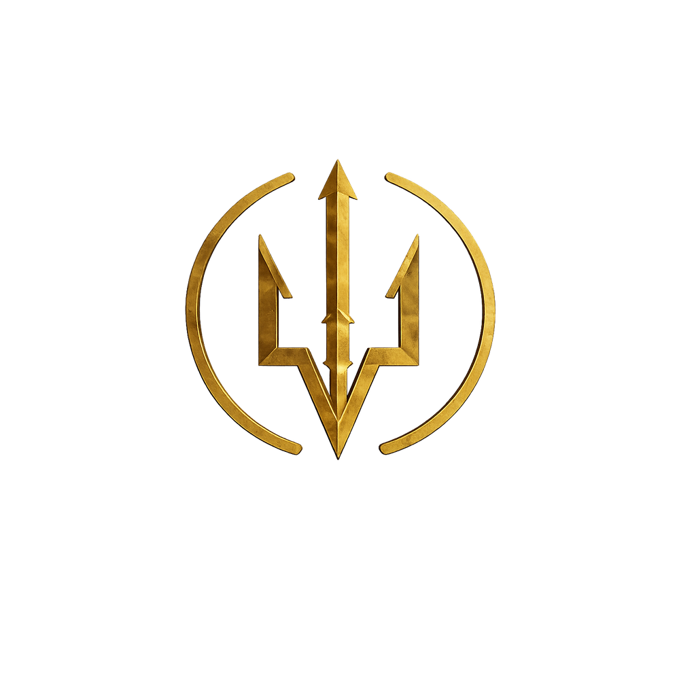
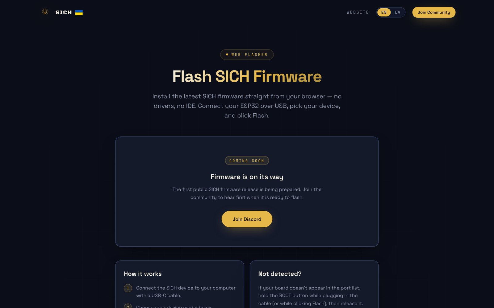
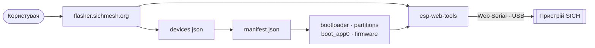

<div align="center">



# SICH Web Flasher

**Прошивка SICH прямо з браузера. Без драйверів, без IDE.**

[](LICENSE)
[](https://github.com/sichmesh/web-flasher/actions/workflows/deploy.yml)
[](https://flasher.sichmesh.org)
[](https://discord.gg/zpVgjRxdQJ)


[**Відкрити прошивальник**](https://flasher.sichmesh.org) · [**Сайт**](https://sichmesh.org) · [**Discord**](https://discord.gg/zpVgjRxdQJ)

[English](README.md) · **Українська**

<br />



</div>

<br />

## Про прошивальник

Офіційний веб-прошивальник для [SICH](https://sichmesh.org) — автономного пристрою зв'язку на LoRa mesh-мережі.

Підключіть пристрій через USB, оберіть модель і натисніть **Flash**. Браузер запише прошивку прямо на плату через Web Serial API.

> [!IMPORTANT]
> Web Serial працює в десктопних **Chrome** та **Edge**. Firefox, Safari і мобільні браузери не підтримуються.

## Підтримувані пристрої

> [!NOTE]
> Перший публічний реліз прошивки SICH — незабаром. До того часу прошивальник показує заглушку. Анонс буде в [Discord](https://discord.gg/zpVgjRxdQJ).

| Пристрій | Чип | Прошивка |
|---|---|---|
| SICH — ESP32-S3 (N16R8) | ESP32-S3 | Незабаром |

## Як додати пристрій

Виробники плат можуть додати своє залізо. Пристрій — це лише папка з файлами прошивки і один рядок у JSON-файлі, без змін у коді.

**1. Додайте прошивку** в `public/firmware/<device-id>/`:

```
public/firmware/<device-id>/
├─ manifest.json
├─ bootloader.bin
├─ partitions.bin
├─ boot_app0.bin
└─ firmware.bin
```

`manifest.json` у [форматі esp-web-tools](https://esphome.github.io/esp-web-tools/):

```json
{
  "name": "SICH Firmware",
  "version": "1.0.0",
  "new_install_prompt_erase": true,
  "builds": [
    {
      "chipFamily": "ESP32-S3",
      "parts": [
        { "path": "bootloader.bin", "offset": 0 },
        { "path": "partitions.bin", "offset": 32768 },
        { "path": "boot_app0.bin", "offset": 57344 },
        { "path": "firmware.bin", "offset": 65536 }
      ]
    }
  ]
}
```

**2. Зареєструйте пристрій** у `public/firmware/devices.json`:

```json
[
  { "id": "<device-id>", "name": "<Vendor> — <Board>", "manifest": "/firmware/<device-id>/manifest.json" }
]
```

Поки список порожній, сторінка показує заглушку «Незабаром».

**3. Відкрийте pull request.** Після злиття пристрій з'явиться на [flasher.sichmesh.org](https://flasher.sichmesh.org).

Версія на сторінці береться з `manifest.json` кожного пристрою, тож завжди збігається з тим, що буде прошито.

## Як це працює



## Розробка

**Потрібно:** Node.js 20 або новіший.

```bash
git clone https://github.com/sichmesh/web-flasher.git
cd web-flasher
npm install
npm run dev        # http://localhost:3000
npm run build      # статичний сайт у ./out
```

## Публікація

Сайт повністю статичний. Кожен push у `main` збирається через GitHub Actions і публікує `./out` на GitHub Pages ([`.github/workflows/deploy.yml`](.github/workflows/deploy.yml)). Власний домен задано у [`public/CNAME`](public/CNAME).

## Пов'язані репозиторії

- [sichmesh](https://github.com/sichmesh/sichmesh) — сайт SICH

## Ліцензія

Вихідний код поширюється за ліцензією [GNU General Public License v3.0](LICENSE).

Назва **SICH** і логотип-тризуб не підпадають під цю ліцензію. Деталі — у [TRADEMARK.md](TRADEMARK.md).

<div align="center">
<br />
<sub>Розроблено українцями 🇺🇦 · <a href="https://www.youtube.com/@BrainFromUkraine">Brain From Ukraine</a></sub>
</div>
