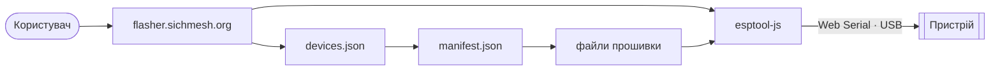

<div align="center">


# SICH Web Flasher

**Прошивка SICH прямо з браузера. Без драйверів, без IDE.**

[](LICENSE)
[](https://github.com/sichmesh/web-flasher/actions/workflows/deploy.yml)
[](https://flasher.sichmesh.org)
[](https://discord.gg/zpVgjRxdQJ)


[**Відкрити прошивальник**](https://flasher.sichmesh.org) · [**Сайт**](https://sichmesh.org) · [**Discord**](https://discord.gg/zpVgjRxdQJ)

[English](README.md) · **Українська**

<br />


</div>

<br />

## Про прошивальник

Офіційний веб-прошивальник для [SICH](https://sichmesh.org) — автономної LoRa mesh-мережі.

Підключіть пристрій через USB, оберіть його зі списку, виберіть версію і натисніть **Прошити**. Браузер запише прошивку прямо на плату через Web Serial API.

> [!IMPORTANT]
> Web Serial працює в десктопних **Chrome**, **Edge** та **Opera**. Firefox, Safari і мобільні браузери не підтримуються.

## Підтримувані пристрої

> [!NOTE]
> Перший публічний реліз прошивки SICH — незабаром. До того часу прошивальник показує заглушку. Анонс буде в [Discord](https://discord.gg/zpVgjRxdQJ).

| Пристрій | Чип | Прошивка |
|---|---|---|
| SICH S3 (референсний) | ESP32-S3 | Незабаром |

## Як додати пристрій

Виробники плат можуть додати своє залізо. Пристрій — це картинка, папка з прошивкою і один запис у JSON-файлі, без змін у коді.

**1. Додайте прошивку** в `public/firmware/<device-id>/<version>/`:

```
public/firmware/<device-id>/<version>/
├─ manifest.json
└─ firmware.factory.bin      (або bootloader.bin, partitions.bin, firmware.bin, …)
```

`manifest.json` у [форматі esp-web-tools](https://esphome.github.io/esp-web-tools/). Шляхи до файлів вказуються відносно маніфесту:

```json
{
  "name": "SICH",
  "version": "2.0.0",
  "builds": [
    {
      "chipFamily": "ESP32-S3",
      "parts": [{ "path": "firmware.factory.bin", "offset": 0 }]
    }
  ]
}
```

**2. Додайте зображення** пристрою в `public/devices/<device-id>.webp` (прозорий фон, приблизно 600×1400).

**3. Зареєструйте пристрій** у `public/firmware/devices.json`:

```json
{
  "id": "<device-id>",
  "name": "<Назва плати>",
  "vendor": "<Ваша компанія>",
  "chip": "esp32-s3",
  "image": "/devices/<device-id>.webp",
  "specs": { "en": "LoRa 868 · GPS", "ua": "LoRa 868 · GPS" },
  "releases": [
    {
      "version": "2.0.0",
      "channel": "stable",
      "manifest": "/firmware/<device-id>/2.0.0/manifest.json",
      "notes": { "en": ["What changed, in a few short lines"], "ua": ["Що змінилося, кількома рядками"] },
      "changelog": "https://github.com/…/releases/tag/v2.0.0"
    }
  ]
}
```

`channel` — це `stable` або `beta`. За замовчуванням обирається найновіший стабільний реліз. Пристрій без релізів показує «Незабаром».

**4. Відкрийте pull request.** Після злиття пристрій з'явиться на [flasher.sichmesh.org](https://flasher.sichmesh.org).

## Як це працює



Під час відкриття сторінка перевіряє, чи браузер підтримує Web Serial. Прошиває [esptool-js](https://github.com/espressif/esptool-js) — офіційний JavaScript-порт esptool від Espressif, який також перевіряє кожен записаний образ.

## Розробка

**Потрібно:** Node.js 20 або новіший.

```bash
git clone https://github.com/sichmesh/web-flasher.git
cd web-flasher
npm install
npm run dev        # http://localhost:3000
npm run build      # статичний сайт у ./out
```

## Публікація

Сайт повністю статичний. Кожен push у `main` збирається через GitHub Actions і публікує `./out` на GitHub Pages ([`.github/workflows/deploy.yml`](.github/workflows/deploy.yml)). Власний домен задано у [`public/CNAME`](public/CNAME).

## Пов'язані репозиторії

- [sichmesh](https://github.com/sichmesh/sichmesh) — сайт SICH

## Ліцензія

Вихідний код поширюється за ліцензією [GNU General Public License v3.0](LICENSE).

Назва **SICH** і логотип-тризуб не підпадають під цю ліцензію. Деталі — у [TRADEMARK.md](TRADEMARK.md).

<div align="center">
<br />
<sub>Розроблено українцями 🇺🇦 · <a href="https://www.youtube.com/@BrainFromUkraine">Brain From Ukraine</a></sub>
</div>
